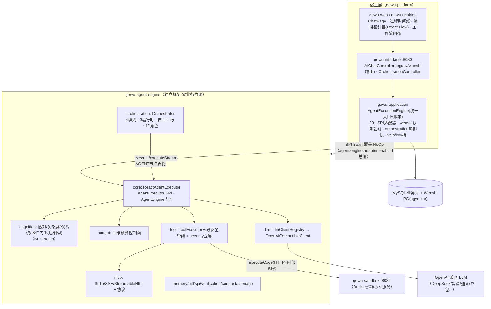
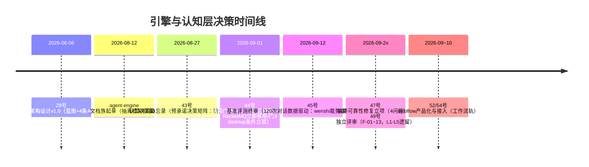

# 格物平台 Agent 智能体引擎设计分析报告（升级参考版）

> **文档编号**：analysis-agent-engine-v2 | **版本**：V2.0 | **日期**：2026-11-10
> **分析对象**：`gewu-agent-engine` 模块（独立引擎框架）及其在宿主 `gewu-application` / `gewu-interface` 中的接入形态，关联澄清 `veloflow-engine`（工作流引擎）与 wenshi（认知管线）的边界
> **分析方法**：三重交叉验证——①双路 Explore 子代理全模块勘察（引擎模块 198 文件 + veloflow 模块 114 文件，2026-11-09）；②设计意图文档考古（`docs/agent-engine/` 15 篇 + `docs/design/29/43/44/45/47/49`）；③关键机制源码亲读核验（路由/压缩/检查点/装配/钩子调用点）
> **前版关系**：本报告是 `docs/analysis/agent-engine-design-analysis.md`（2026-09-17，V1）的升级替代版。V1 之后引擎有三项实质演进（上下文压缩落地、检查点 DB 化、编排版本化+子图+Webhook 触发体系），已按当前工作区（`fix/sandbox-security-storage` 分支）代码重新实证并标注差异
> **证据分级**（LPU 纪律）：**A** = 代码直接证据（file:line 亲读）；**B** = ≥2 独立来源推断；**C** = 单源推断，仅列待确认清单、不得作为升级决策依据
> **工具说明**：任务要求的 codebase-memory-mcp 在本次会话工具清单中不存在，未调用；以上述三重交叉验证替代，结论锚点均可按 file:line 复核

---

## 一、执行摘要

**设计思想一句话**：**"ReAct 即默认内核，编排即图，认知即 SPI，安全即默认拒绝"**——教科书式 ReAct 循环只是最内层的执行策略，外面套了图编排、认知决策、预算控制、安全纵深四层，全部业务能力经 20+ SPI 端口由宿主注入，框架本身零业务依赖、可独立发布。

六条核心结论：

1. **这不是简单 ReAct 引擎**。生产运行的 `ReactAgentExecutor`（2269 行，2026-11-11 实测 @8234a71）在同一循环内整合了：前置认知决策链、四维预算熔断、五层安全管线、语义缓存、上下文压缩、截断自愈、死循环检测、内置五件套工具（plan_task/文件四件套/ask_user/spawn_subagents）。其形态与编码类 Agent 主流内核（Claude Code/OpenAI Agents SDK 的 harness 派）同构（§六）。
2. **双引擎并存已被数据驱动收敛**。legacy（ReactAgentExecutor）与 wenshi（三层认知管线）由 `gewu.wenshi.routing.chat/stream` 配置切换；45 号终审（120 次基准评测：wenshi 质量 -0.4%、时长 2.4x）裁剪回 legacy。收敛不是删除——wenshi 降级为 SPI 能力供应方（记忆/反思/仲裁/经验经适配器反向注入 legacy 引擎），直连路由保留作评测通道（§四.2）。
3. **"引擎不绑库"是全套设计的支点**。框架仅依赖 Spring Boot/Reactor/Jackson/Lombok，所有平台能力（DB、密钥、沙箱、记忆、审计、认知）经 SPI + `@ConditionalOnMissingBean` NoOp 兜底注入，宿主 20+ 适配器一键增强（§三.11）。这使引擎具备独立开源/复用形态，也是后续升级时必须守住的不变量。
4. **设计意图与代码实现存在系统性分叉**。设计文档已分裂为三层叙事：29 号平台内 AOE 蓝图（2026-08-06）→ 抽离框架文档族（2026-08-12）→ 平台实现快照（14 篇 + 47/49 号，持续追加）。22 条意图-实证出入点中，Supervisor 智能路由、CapabilityCard 消费、角色提示词、ExecutionScheduler 等属于"文档声明但未落地"（§五）。
5. **编排子系统"实现完整、主链路未经过"是有意识决策而非烂尾**。41→43→44→45 号形成完整的预承诺决策链（决策规则先于数据承诺，防沉没成本）；D-6 认知接线点已在 `planExecution` 预留（`systemChoice.runtimeMode`），触发条件 = 知识库填充后复评 Δ质量 ≥+5%（§四.1）。
6. **升级的最大短期风险在可靠性遗留而非能力缺口**。49 号独立评审（2026-09-26）的 L1/L2 遗留（子 Walk 终态桥接、Webhook 限流/异步化）是特性开关（`subgraph.enabled`/`webhook.enabled`，均默认关）开启的硬前置；多副本化（veloflow 单实例锁、SSE 广播）是部署形态升级的硬前置（§七、§八）。

---

## 二、设计思路还原（意图层证据）

### 2.1 定位与对标

| 项 | 声明 | 出处 |
|---|---|---|
| 定位 | 从格物平台抽离的"可独立引入的 Agent 引擎框架"，Spring Boot 项目引依赖 + 按 SPI 实现即得完整 Agent 能力 | docs/agent-engine/README.md:3,11 |
| 对标 | LangGraph / AutoGen，"但面向 Java + Spring Boot 生态" | README.md:11、01-overview.md:62-75 |
| 差异化 | "不追求比对手更灵活，追求 Java/Spring 生产环境下开箱即用、安全可控、业务无侵入"——把安全管线/SPI 契约/供应商路由等生产基建作为一等公民 | 01-overview.md:77 |
| 自认劣势 | 状态持久化不如 LangGraph 内建 Checkpointer，由使用方实现 | 01-overview.md:74 |
| 适用/不适用 | 适用：企业助手、SDLC Agent、多 Agent 协作、自主目标、安全代码执行、MCP 接入；不适用：纯 Python 栈、单轮问答、不关心安全的实验项目 | 01-overview.md:79-88 |

### 2.2 设计原则（文档明文）与落地评价

| # | 原则 | 原文出处 | 代码落地评价（实证） |
|---|---|---|---|
| 1 | **零业务依赖** | README.md:124、01-overview.md:14-23 | ✅ A 级：pom 仅 spring-boot/autoconfigure/reactor/jackson/lombok（gewu-agent-engine/pom.xml:17-58），零 com.gewu 依赖 |
| 2 | **抽象优先 + SPI 扩展（NoOp 兜底）** | README.md:125、01-overview.md:29 | ✅ A 级：11 个逻辑 SPI/14+ 接口全带 NoOp 默认（10-spi-reference.md:5-25），`AgentEngineAutoConfiguration`（710 行）全部 `@ConditionalOnMissingBean`，零业务实现可启动 |
| 3 | **流式优先（Reactor Flux）** | README.md:126 | ✅ A 级：`executeStream` 返回 `Flux<AgentEvent>`，HITL 用 `Mono<HumanDecision>` 不阻塞线程；SSE 写帧在宿主 Controller 退化为 `StreamingResponseBody` 手写（Spring MVC ReactiveTypeHandler 会缓冲整个 Flux，AiChatController.java:110 附近注释） |
| 4 | **双轨注册（代码 + 配置源）** | README.md:127 | ✅ A 级：ToolRegistry/LlmClientRegistry/RoleRegistry 均 `putIfAbsent` 外部优先、内置默认保留（02-architecture.md:252-256） |
| 5 | **编排即图（消除双轨）** | README.md:128、01-overview.md:35、design/29:127-143 | ⚠️ 部分落地：编排图引擎完整实现（7+1 节点/4 模式/3 运行时），但 ADR-001 设想的"工作流引擎降级为图执行器后端"未发生——实际走向 veloflow 双轨互操作（§四.3），"单轨"仍限于编排层内部愿景 |
| 6 | **安全内建、默认拒绝** | 01-overview.md:37 | ✅ A 级：SSRF 白名单默认空 = 拒绝全部外部主机（05-tool-layer.md:211-214）；NoOpSandboxExecutor 是全 SPI 中唯一 fail-closed（10-spi-reference.md:115），其余 NoOp 均 fail-open——该不对称是刻意的，但带来治理问题（§七 P0-4） |

装配层不变量（02-architecture.md:252-256）：**零配置可启动**（不实现任何 SPI 装配不失败）、**按需替换逐层增强**（扩展=注册 Bean 而非改框架）、**静态+动态双轨**。

### 2.3 重要元发现：设计文档的三层分裂

设计意图层不是一个声音，而是三个时代的叠加（B 级，多文档交叉）：

1. **29 号平台内 AOE 蓝图**（2026-08-06）：DDD 分层、复用 Wenshi/工作流引擎、DB 表驱动、国密合规——目标是"平台能力升级"；
2. **agent-engine 文档族**（2026-08-12 起草的 01-13 篇）：抽离后的独立框架叙事——去业务依赖、SPI/NoOp 化、对标 LangGraph/AutoGen；
3. **平台实现快照**（14-system-prompt-inventory + 47/49 号，2026-09~10）：持续追加平台实战能力（PLAN 节点、波次映射、内置工具、提示词清单、可靠性修复）。

两套概念体系（编排即图/四模式/三运行时/六重边界/EvolutionHook）共用，但细节已分叉：节点类型 7 种 vs 7+PLAN、HitlGateway 签名（Flux+EscalationPolicy vs Mono+timeoutSeconds）、事件集（experience_saved vs goal_start）、ExecutionMode 枚举（4 vs 3）、@RoleProvider vs RoleConfigSource。**升级设计应以第 3 层（代码+14 篇+47/49）为事实基线，第 1/2 层作为意图参考并标注 superseded 项**——这是文档收口动作的依据（§八.短期-1）。

### 2.4 ADR 决策记录（29 号，全部"已批准"）

| ADR | 决策 | 理由 | 后果/现状 |
|---|---|---|---|
| ADR-001 | 引入编排图统一抽象，消除双轨 | 混合编排 + 向后兼容（工作流可导出为图） | 编排引擎建成；"工作流降级为图执行器后端"未发生，实际为双轨互操作（design/29:1047-1053） |
| ADR-002 | 四模式 ModeHandler 策略化（PIPELINE/SUPERVISOR/SWARM/DEBATE） | 单一模式无法覆盖动态分派/固定流程/探索交接/多方案决策四类场景 | 已实现；SUPERVISOR 为简化实现（顺序执行，LLM 路由交使用方 ReasoningKernel，07-orchestration.md:147） |
| ADR-003 | 进化闭环嵌入编排钩子（非独立运行） | 每次执行自动产生进化数据，无需额外触发 | ✅ AutonomousExecutor 真实调用 EvolutionHook（AutonomousExecutor.java:122/150/161/228，A 级本轮核验）；异步不阻塞约束待验证（C 级） |
| ADR-004 | 自主循环强制六重设界（迭代 5/Token/时间 30min/强制 HITL/回退 3 次/配额） | "Agent 自主性与安全性必须平衡，边界触发即升级人工"（29:1071-1077） | AntiRunawayGuard 已实现（:47-89）；但"HITL 强制"依赖 NoOp 直批语义，未接宿主实现时形同虚设（§七 P0-4） |

---

## 三、技术设计原理（实证层）

### 3.1 总体分层与依赖方向



依赖方向不变量（02-architecture.md:86，A 级）：高层依赖低层抽象、低层不反向依赖；能力层互不依赖；**orchestration 横向依赖 core，core 不感知 orchestration**。

### 3.2 执行内核 ReactAgentExecutor（2269 行 @8234a71，生产唯一 AgentExecutor 实现；行号基准见 §9.3）

#### 3.2.1 前置决策链 `planExecution`（:1707，同步/流式共用）

```
PerceptionEngine 感知（非结构化输入→结构化 Intent）
  → ComplexityRouter 复杂度评估（L1/L2/L3，规则+特征）
  → BudgetController.createBudget 按级配额（L1=token/5+30s+3轮，L3=×3/×4/×2；会话任务 L1 强制抬到 L2 :1718）
  → 注入用户套餐配额（quotaTokenBudget/quotaBlockEnabled）
  → ModelSelector 模型路由（返回 null 即不干预；gewu.llm.routing.models 未配置时不生效）
```

产出 `systemChoice.runtimeMode/modelTier` —— **这是 D-6 认知接线的预留点**。43 号文档（2026-08-27）曾断言"接线即在 execute/executeStream 按 runtimeMode 分派 PLAN_EXECUTE 运行时，无需预开发"；**该断言已被后续实测推翻（2026-11 独立评审 F-01，RPT-002）**：PlanExecuteRuntime 当前全仓零外部消费方、`concatMap` 逐节点串行执行（fromPlanGraph 生成的并行波次被拉平）、事件重映射丢弃 metadata（ask_user/plan_* 等带元数据事件透传即损，HITL 回灌会断）、PARALLEL/MERGE 伪节点未按类型过滤——接线前必须完成运行时适配（§八 中期-6 前置项 / 实施计划 AE-P1-1）。

#### 3.2.2 同步主循环（:203-366）

每轮固定顺序：**先续期、后熔断**（时间满额但 Token/轮次健康 → `renewTimeBudget` 滚动续期 `elapsed+max(base/2,30s)`，不终止——解决"熔断误杀长推理任务"）→ Token/轮次熔断检查（仅这两维 BLOCK，时间维降为告警，S9 方案 A）→ LLM 调用（OTel Span 包裹）→ 真实 usage 记账（按模型定价拆输入/输出）→ 无工具调用则收尾（**截断自愈**：finish=length 时 max_tokens 翻倍重试 ≤3 次、硬顶 65536，且 token×2/时间≥elapsed×3/轮次+1 同步扩容，防止重试在循环头被熔断）→ 有工具调用则 CompletableFuture 并行执行 → 观察回灌（role=tool + toolCallId，synchronized 保护消息列表）→ 死循环 nudge 注入。

#### 3.2.3 流式路径（:374 起，递归 `streamRound` :468）

chunk 级事件映射（reasoning→THINKING、delta→CONTENT、toolCallDelta 增量累积器重组）；轮首发 70%/90% 预算告警事件，熔断后**补发 `done(finishReason=budget)`** 保证前端生命周期完整；截断重试先发 `CONTENT_RESET` 清空前端半截正文再整体重生成；轮次到顶滚动扩容 50%（`renewRounds` 最多 2 次）；流式 Token 按字符/3 估算记账；超限统一走 `summaryOnLimit`（:837）——发一次无 tools 的总结调用，把失败变降级完成。`doFinally` 区分：熔断/超限不沉淀经验，成功路径 PII 脱敏后沉淀经验（:438-451）。

#### 3.2.4 内置工具五件套（不走 ToolExecutor 安全线，引擎内直接分发）

| 工具 | 机制 | 位置 |
|---|---|---|
| `plan_task` | Plan 模式：模型自主维护任务清单，markdown 落盘工作空间 plan/ 目录，发 plan_created/plan_updated 事件 | :97 |
| `read_file/write_file/edit_file/list_dir` | 经 `FileWorkspaceSpi` 路由到会话沙箱工作区 | :1021 |
| `ask_user` | HITL 问答：头部发 ASK_USER 事件后流挂起，等 `UserInteractionGateway.askQuestion` 回灌 | :1187 |
| `spawn_subagents` | 主 Agent 动态派生 N 个独立 ReAct 子会话（独立 messages/预算/ToolContext）并行执行后聚合回灌；深度护栏 maxDepth=2、独立线程池防嵌套 join 死锁、子消耗折算入父预算、流式分支事件打 subagentId 分桶 | :1257-1534 |

#### 3.2.5 上下文管理与压缩（相对 V1 报告的演进项，本轮核验已实现）

`maybeCompactContext`（:981，A 级）：经 `ContextCompactor` SPI 压缩历史——保留系统提示 + 最近 N 轮 + 旧内容摘要；阈值 `context-compact-threshold: 0.8`、`keep-rounds: 4`（application.yml），每执行最多 5 次。调用点 :891（流式循环内）。**V1 报告"无 token 级上下文压缩"的结论已过时**——压缩骨架已落地，剩余差距在宿主 Compactor 实现的摘要质量（当前宿主侧实现成熟度 C 级，待确认）。

#### 3.2.6 语义缓存与经验沉淀

语义缓存命中直返（:184/:396，零 LLM 成本；截断的部分内容不入缓存）；成功执行经 `MemoryStore` SPI 沉淀经验（实现 = 宿主 WenshiMemoryStoreAdapter → Wenshi PG），下次对话经 `MemoryRouter` 注入。**引擎与 wenshi 的实际关系在此显现：legacy 引擎是执行内核，wenshi 是它的记忆/经验器官**（§四.2）。

### 3.3 LLM 抽象层

- `LlmClient` 三方法刻意极简（04-llm-layer.md:8）；`LlmClientRegistry` 多供应商注册/路由中心：静态代码注册优先、`LlmProvider` SPI（DB 配置源）动态兜底创建 `OpenAiCompatibleClient`；
- `OpenAiCompatibleClient`：OpenAI Chat Completions 兼容（类注释点名 DeepSeek/智谱/豆包/LongCat/通义），`reasoning_content` 分离传输映射 THINKING/CONTENT 两事件（自称"关键差异化点"，04-llm-layer.md:127）；
- 可靠性参数（47 号修复后现状，A 级）：连接 30s / 请求 120s / **流式空闲看门狗 60s**（`stream-idle-timeout-ms=60000`，无数据即中断防上游挂死）/ 重试 `max-attempts=2, backoff-ms=1000`，429 受限重试、400/401/403 不重试（47 号 §四）；
- 强制 HTTP/1.1（HTTP/2 流控可能缓冲 SSE 响应体，04-llm-layer.md:165,193）；SSE 读取在 boundedElastic（阻塞 readLine 不能占事件循环）；
- apiKey 契约：进引擎的必须是**已解密明文**，解密责任在宿主（`ApiKeyDecryptor` SPI → 宿主 SM4 实现，密钥 `gewu.crypto.api-key-secret`）。

### 3.4 工具体系与五层安全纵深

`ToolExecutor` 五步管线：**安全检查 → 权限评估 → 类型分发（本地注册/HTTP/MCP/沙箱）→ 输出截断 10KB → WORM 审计**。纵深五层（tool/security/）：

| 层 | 实现 | 说明 |
|---|---|---|
| ① 输入安全 | `PromptInjectionDetector` | 引擎入口调用，高风险拦截/中风险告警 |
| ② Schema 校验 | `SchemaValidator` | 参数 JSON Schema 校验，自动加入 SecurityChain |
| ③ 工具安全 | `SsrfValidator` + `DefaultCodeScanner` + `PermissionService` | SSRF 默认拒绝全部外部主机+内网地址、白名单放行、重定向逐跳复验；code_execute 危险代码扫描 |
| ④ 沙箱隔离 | `SandboxExecutor` SPI → gewu-sandbox（独立 :8082 服务） | 容器加固：no-new-privileges/cap-drop ALL/只读根fs/tmpfs noexec/network=none/CPU内存限额；agent 沙箱 300s 强制销毁；Firecracker microVM 仅枚举+文档无实现 |
| ⑤ 输出安全 | `OutputSanitizer` | PII 脱敏（手机号/邮箱/身份证）后才持久化/缓存/返回 |

工具来源三通道：代码注册（`@ToolProvider`）、DB 配置（`ToolConfigSource`，agent_tool 表含 requestSchema）、MCP 动态发现。**工具层无通用重试**（重试只在 LLM 截断自愈层）——工具级超时 30s 由 ToolContext 携带。

### 3.5 预算控制面（四维状态机）

```
NORMAL →(利用率≥70%) ALERT(budget_warning) →(≥90%) DEGRADE(信号→ModelSelector换便宜模型)
       →(Token/轮次超限) EXCEEDED：BUDGET_EXCEEDED + done(finishReason=budget)
                                记失败账本 · 不沉淀经验 · 不写缓存
NORMAL →(时间满额但Token/轮次健康) 滚动续期，不终止
```

- 熔断范围仅 Token/轮次 BLOCK，时间维告警（S9 方案 A 重构，BudgetController.java:106-128）；
- 复杂度分级配额：L1=token÷5/30s/3 轮，L2 基线（宿主 max-tool-rounds=50），L3=×3/×4/×2；
- 截断自愈主动升预算（§3.2.2）；编排侧另有 `AntiRunawayGuard` 六重边界 + `AgentLifecycleManager`（心跳 60s/全局 300s/DFS 死锁环检测）；
- 用户套餐配额预检在宿主 `AgentExecutionEngine.applyUserQuota`（未绑定套餐显式下发不限量哨兵，修复"旧默认 82K 中途熔断未绑定用户"缺陷）。

### 3.6 认知与记忆 SPI（cognition/）

五端口 + 决策组件：`PerceptionEngine`（感知）、`ComplexityRouter`（L1/L2/L3）、`DualSystemRouter`（System1/2 决策，**观测态**：分类逻辑经 45 号基准验证正常，不接线）、`ConfidenceGate`（四级置信度：≥0.85 采纳/≥0.6 换模型/≥0.6 换上下文/<0.4 升级人工；**已知缺陷**：简化重载固定项 0.5，单 Critic 场景最差只能 RETRY_CHANGE_CONTEXT 永远到不了 ESCALATE_HITL——接线时必须用全参重载，43 号 §三.1）、`ReasoningKernel`（Planner/Solver/Critic）、`ReflectionEngine`、`ArbiterEngine`、`EvolutionHook`（目标生命周期钩子，AutonomousExecutor 真实调用）。记忆：`MemoryStore`（四类记忆存储 SPI）+ `MemoryRouter`（检索注入 SPI），引擎内置 NoOp 返回空，**"四类记忆"是宿主 wenshi 侧的事实而非引擎能力**（引擎文档自认，09-memory-cognition.md:73）。

NoOp 语义的刻意不对称（设计要点）：认知/记忆/HITL 全部 **fail-open**（NoOpReasoningKernel critique 恒 accepted=true、NoOpHitlGateway 直接 APPROVED——"不阻塞、直接批准"），唯独 `NoOpSandboxExecutor` **fail-closed**（抛 SANDBOX_NOT_CONFIGURED，10-spi-reference.md:115）。理由：沙箱缺位直接放行代码执行是不可接受的安全事故；而认知缺位只损失质量。**该不对称的推论未贯彻**：HITL 在"删除/生产变更强制审批"场景 fail-open 与 29 号安全红线矛盾（§七 P0-4）。

### 3.7 编排子系统（orchestration/）

- **图模型**：`OrchestrationGraph/GraphNode/GraphEdge`（refId 引用解耦、图级 variables、边 condition）；NodeType = AGENT/TOOL/HUMAN/ROUTER/PARALLEL/MERGE/SUBGRAPH + **PLAN**（7.15.3 新增：输入→GoalPlanner 规划→发 PLAN_CREATED→波次映射为子图→同上下文内联执行，planDepth 限 1 防递归，07-orchestration.md:373-384）；
- **四模式**（ModeHandler 策略注册表）：PIPELINE（边驱动遍历：无入边起步/ROUTER 条件选边/PARALLEL 并发扇出 activePaths 计数/MERGE 汇聚等待 mergeArrive 计数——不变量"汇聚必须等全部可达分支"，ROUTER 跳过分支后对其下游 MERGE 静态计数做可达性扣除，修复"部分产出 SUCCESS 收尾"静默丢分支缺陷）；SUPERVISOR（标准信封 TASK_DELEGATE/TASK_RESULT，**简化实现**顺序执行）；SWARM（无中心，输出嵌 `HANDOFF:target|reason`/`FINISH` 指令正则解析，handoffChain+maxHandoffs=8 双保险防环）；DEBATE（多方辩论+裁判节点）；
- **三运行时**（AgentRuntime SPI）：REACT（=现有循环封装，ADR"Runtime 不重写而是组合"）；PLAN_EXECUTE（LlmGoalPlanner 产出计划图→`ExecutionGraph.fromPlanGraph` Kahn 波次映射：同波次无依赖步骤生成 `PARALLEL→[AGENT×N]→MERGE` 并行段——修复"AGENT 多出边只走第一条"历史缺陷；inputs 模板 `${var}` 渲染）；REFLEXION（**简化透传壳**，D-5 裁剪维持）。**就绪度警示（2026-11 评审 F-01）**：三运行时均为未接线半成品——零外部消费方；PlanExecuteRuntime 实际 `concatMap` 串行执行（并行波次被拉平）、事件重映射丢 metadata、PARALLEL/MERGE 伪节点未过滤；节点级接线议题见 roadmap P2-11（🟡待评估），分工勘定列实施计划阶段 0；
- **自主目标外循环**：`AutonomousExecutor` 分解→执行→验收（`DualLoopVerifier` 内环 Critic ≤5 轮+收益递减检测、外环 LLM 仲裁 ≤2 轮；ConfidenceGate 四级门控）→ 不通过反思重规划；入口 `AntiRunawayGuard` 六重防失控；EvolutionHook 全生命周期回调（成功/失败/图完成）；
- **角色注册表**：`RoleRegistry` 内置 12 个 SDLC 角色 = 能力卡 + 工具集 + 记忆域 + 执行模式；**`systemPromptTemplate` 默认角色未预置提示词文本**（14-system-prompt-inventory.md:340）——角色体系当前是"能力卡空壳"；CapabilityCard 无 role 包外消费方（本轮 grep 核验，A 级）——Supervisor"按能力卡路由"是文档愿景非实现；
- **宿主编排轨**（gewu-application/orchestration/）：OrchestrationService（图 CRUD/激活/执行/SSE/断点恢复）、GraphDefinitionValidator（VL-01~14）、版本化激活（definition_snapshot 不可变快照 + 版本回滚）、DbOrchestrationCheckpointStore（**检查点双写 DB**，本轮核验 A 级；V1 报告"纯内存"结论过时）、DbSubgraphResolver、OrchestrationScheduleRunner（CAS 抢占+NULL 锁自愈）、编排设计器（React Flow，46/55 号）。

### 3.8 HITL 双网关

| 网关 | 场景 | 形态 | 宿主实现 |
|---|---|---|---|
| `HitlGateway`（编排审批） | 图执行 HUMAN 节点 | `Mono<HumanDecision>` 挂起等待，timeoutSeconds | `DbHitlGatewayAdapter`：approval_request 表 + SSE 通知 + Mono Sink 阻塞恢复 |
| `UserInteractionGateway`（chat 问答） | ReAct 循环 ask_user | 流挂起 + 事件回灌 | `ChatUserInteractionGateway`（需 adapter.enabled 开启） |

设计文档中的 EscalationPolicy/RocketMQ 超时升级未落地（RocketMQ 已按 44 号门 2 全量移除，DomainEventPublisher 转本地 Spring 事件）。

### 3.9 MCP 子系统

三种传输（`StdioMcpClient`/`SseMcpClient`/`StreamableHttpClient`）+ `McpServerManager`（注册/发现/连接缓存）+ `McpServerConfigSource` SPI（宿主 DB 配置源）。工具经 ToolExecutor 统一走五段管线，MCP 工具与本地工具无特权差异。

### 3.10 事件协议（流式契约）

`AgentEvent` 30+ 种常量（core/event/AgentEvent.java:93-160）：基础 8 类（status/thinking/content/tool_call/tool_executing/tool_result/done/error）+ `content_reset`（截断重放）+ `plan_created/plan_updated` + `subagent_status` + `ask_user` + `budget_warning/budget_exceeded/confidence_check/verification_result/reflection/experience_saved` + 编排层 12 类（graph_start/node_start/handoff/approval_required/goal_* 等）。前端消费：gewu-web `consumeChatSse()`（lib/chat.ts:277-399，60s 空闲看门狗配后端 20s ping）→ `handleStreamEvent`（content_reset/tool_*/budget_*/plan_* 分发）→ AIProcessTimeline 过程时间线渲染 + metadata.process 持久化还原。**该事件协议是引擎的对外契约核心，升级时向后兼容约束集中于此**。

### 3.11 SPI 端口全景与框架-宿主分离

| 分组 | 端口（接口） | 宿主实现（gewu-application/agent/adapter/，全部 @ConditionalOnProperty agent.engine.adapter.enabled） |
|---|---|---|
| 平台横切 | PersistenceService / SessionContextService / PermissionService / AuditService / SandboxExecutor / ResponseCache / ModelSelector / ApiKeyDecryptor / ContextCompactor / ModelContextProvider / CostCalculator / TraceService / MetricService / PolicyService / FileWorkspaceSpi(tool包) | DbPersistenceServiceAdapter / DbSessionContextServiceAdapter / DbPermissionServiceAdapter / DbAuditServiceAdapter(WORM) / DbSandboxExecutorAdapter / SemanticResponseCacheAdapter(pgvector) / ModelSelectorAdapter→ModelRouter(gewu.llm.routing.models 驱动) / SmApiKeyDecryptorAdapter(SM4) / ModelContextProvider 等 |
| LLM/工具 | LlmProvider(llm包) / ToolConfigSource(tool包) / McpServerConfigSource(mcp包) | DbLlmProviderAdapter / DbToolConfigSourceAdapter / DbMcpServerConfigSourceAdapter |
| 认知（wenshi 桥） | ReasoningKernel / ArbiterEngine / PerceptionEngine / ReflectionEngine / EvolutionHook / MemoryStore / MemoryRouter | WenshiReasoningKernelAdapter / WenshiArbiterEngineAdapter / WenshiPerceptionEngineAdapter / WenshiReflectionEngineAdapter / WenshiEvolutionHookAdapter / WenshiMemoryStoreAdapter / WenshiMemoryRouterAdapter |
| HITL | HitlGateway / UserInteractionGateway | DbHitlGatewayAdapter / ChatUserInteractionGateway |
| 编排 | SubgraphResolver / OrchestrationCheckpointStore / RoleConfigSource / GoalPlanner / ScenarioAdapter | DbSubgraphResolver / DbOrchestrationCheckpointStore / — / LlmGoalPlanner(引擎内置,默认关) / — |

**装配协议**：`META-INF/spring/...AutoConfiguration.imports` → `AgentEngineAutoConfiguration`（710 行，7 组装配全 `@ConditionalOnMissingBean`）→ 双隔离线程池（`agentToolExecutor` 8-16 线程队列 100 CallerRunsPolicy + `agentSubAgentExecutor` 独立防嵌套 join 死锁）→ 核心 Bean。**开关语义警示**：`agent.engine.adapter.enabled=false` 不是"回到简化引擎"，而是让引擎整体退化到 NoOp（无 LLM 供应商、无沙箱、无审计）——它是能力总闸而非引擎选择开关。

### 3.12 配置体系（宿主实际生效值，application.yml:88-199）

| 配置组 | 关键项（生效值） | 语义 |
|---|---|---|
| agent.engine.adapter | enabled=true | SPI 适配层总闸 |
| agent.engine.engine | max-tool-rounds=50（L2 基线，"轮次只兜底、防线靠死循环检测"）/ loop-stop-threshold=10 / context-compact-threshold=0.8, keep-rounds=4 / rounds-renew=true,max=2 / subagents.*(enabled/maxPerSpawn=5/maxDepth=2/timeout=180s) | 循环行为 |
| agent.engine.llm | connect/request-timeout / stream-idle-timeout-ms=60000 / retry.max-attempts=2, backoff-ms=1000 | LLM 可靠性（47 号修复后） |
| agent.engine.tool | allowed-hosts 白名单 / max-output-size=10KB / timeout 30s | 工具安全 |
| agent.engine.budget | token-budget=81920 / time-budget-ms=300000 / alert=0.7 / degrade=0.9 / cost-budget=0(仅记账) / L1÷5·30s·3轮 / L3×3·×4·×2 | 预算 |
| agent.engine.planner.llm | enabled **默认 false**（AutoConfiguration:571 核验） | LLM 目标规划器灰度开关 |
| gewu.wenshi.routing | chat=legacy(默认) / **stream=legacy（yml 钉死，注释引 45 号终审）** | 双引擎路由 |
| gewu.semantic-cache | enabled/threshold=0.95/disabled-agents | 语义缓存分场景 |
| gewu.llm.routing.models | 未配置 → 模型路由不生效 | 模型路由前置条件 |

---

## 四、决策链与引擎演进史

### 4.1 预承诺决策链（41→43→44→45）——本项目最值得复用的工程实践



43 号的**预承诺规则**是关键机制——在拿到数据前先承诺决策规则，杜绝"先做再找理由"：

| 数据形态 | 决策 | 动作 |
|---|---|---|
| Δ质量 ≥+5% 且 Δ成本 ≤+20% | 接线 | D-6 接线（System2→PLAN_EXECUTE+modelTier 驱动 ModelSelector）；D-5 实现真实反思循环 |
| Δ质量 <+2% 或 Δ成本 >+50% | 裁剪 | 保留 SPI、实现进维护态 |
| 之间 | 缩小范围 | 仅 L3 复杂任务分组启用 |

45 号实测：legacy 5.64 分/35.8s，wenshi 5.61 分/84.3s → 双重不达标裁剪。**裁剪根因被明确记录：知识库为空（wenshi_semantic_fragment 0 行），三层认知增强无从发挥**——即被裁剪的是"空转的管线开销"而非认知路线本身，复评触发器（知识层灌入+经验库填充后重跑同题集）随之预承诺。

### 4.2 双引擎并存与收敛形态（承 V1 报告，浓缩）

- legacy = `ReactAgentExecutor`（独立框架模块），wenshi = `WenshiReasoningEngine`（宿主三层认知管线 Planner→SolverRouter→Critic，不实现 AgentExecutor SPI）；
- 切换：`AiChatController`（:93-161）——请求级 `engineOverride` 优先，否则全局路由配置；`"wenshi".equals(engine) && wenshiReasoningEngine != null` 守卫，Bean 缺失**静默回退 legacy**（评测场景的数据失真风险，§七 P2）；
- 收敛形态：**执行内核=legacy，认知增强=wenshi（经 SPI 适配器注入），控制器直连路由仅剩评测用途**；wenshi 路径执行账本在控制器手工补记（beginExecutionRecord/endExecutionRecord）——双链路并存的对账补丁。

### 4.3 veloflow 分轨与双向互操作（28 号"两轨并存不合并"的落地）

veloflow-engine（114 文件，零 com.gewu 依赖，13 张 VLF_ 表，24 种节点 Handler，持久化等待驱动内核）是**工作流/流程引擎**（对标 Camunda 治理深度 + n8n 节点广度），不是 agent 引擎——内核无 LLM 客户端、无对话循环。互操作双向打通：

- agent→工作流：`RunWorkflowTool`（@ToolProvider，ToolRegistry 自动发现）暴露 run_workflow，发起实例后有界线程池 500ms 轮询至终态（等待帽 agent.engine.tool.workflow.timeout-seconds=300）；
- 工作流→agent：llm/agent/orchestration/knowledge 四类 AI 节点经 `FlowAiBridge` SPI 回调宿主——agent 节点直调 `AgentExecutor.execute()`（sessionId=工作流实例 ID 可追溯），编排哲学："AI 深度归编排轨，工作流只做调用与消费"。

**对 ADR-001 的修订观察（B 级）**：29 号设想"工作流降级为图执行器后端、双轨统一为单轨"未发生；实际落地的是"编排引擎（Agent DAG 自主执行）+ 工作流引擎（人工审批/系统集成流）双轨 + 双向工具级互操作"。从 52/54 号的产品化投入看，双轨互操作已被组织接受为稳态——升级设计时应把"是否继续推进单轨统一"作为显式再决策项（§八.长期-1）。

### 4.4 编排可靠性修复（47/49 号）——最新质量基线

47 号立项修复 4 问题：①AGENT 失败传播语义（**双模式图级可配** `config.continueOnFailure`，旧行为可配置 100% 保留）；②LLM 超时体系（空闲 180s→60s 等全参数化）；③429 受限重试；④节点执行记录落库（orchestration_node_execution 事件桥接处幂等 upsert——V1 报告"有表无写入"的缺口按此修复，是否已交付未在 49 号遗留表中出现，推断已修，B 级）。

49 号独立评审（2026-09-26，O1~O3 基线）：2 项 P1 已修（F-01 流式路径终态覆写 PAUSED/CANCELLED→SUCCEEDED 的状态桥接缺陷、F-02 定时调度 NULL 锁停摆自愈）、8 项本轮修复、**5 项遗留（L1-L5）**：子 Walk 终态委托与父链检查点（SUBGRAPH 开启前置）、Webhook 限流+异步执行（webhook.enabled 开启前置）、TOOL 参数结构化渲染、补回归测试、O4 PLAN_EXECUTE 接线。**两个特性开关（subgraph.enabled/webhook.enabled）默认关闭且有书面开启前置**——这是升级排期的硬约束。

---

## 五、设计意图 vs 代码实证出入清单（归并 15 条）

> 考古代理产出 22 条，归并同名/同类后 15 条。处置列：✅已核验落地 / ⏳未落地（升级候选项） / 📋待人工确认（C 级）

| # | 文档声明 | 实证结论 | 置信 |
|---|---|---|---|
| 1 | SPI 数量：README"11 个" vs overview"12+" vs 参考"11 逻辑/14 接口" | 口径不一，实际按本报告 §3.11 表为准 | A |
| 2 | 03 篇把 ReactAgentExecutor 描述为 ~320 行极简循环 | 实际 2269 行 @8234a71（内置五件套/压缩/子代理/预算收尾均后补进单类）——"极简引擎"叙述严重滞后 | A |
| 3 | Supervisor 按 CapabilityCard 智能路由（29:293-298） | 简化实现顺序执行（07:147 自认）；CapabilityCard 无 role 包外消费方 | A |
| 4 | GoalPlanner 三级路由（经验→LLM→Critic） | 接口 Javadoc 意图；Default 单节点回退，LlmGoalPlanner 默认关 | A |
| 5 | ReflexionRuntime 完整 Critic→reflect→重试闭环 | 简化透传壳（D-5 裁剪维持，预承诺复评） | A |
| 6 | 六重防失控边界含"强制 HITL + 超预算暂停审批" | AntiRunawayGuard 已实现；但 HITL 依赖 NoOp 直批语义，"超预算请求追加审批"未实现 | A |
| 7 | EvolutionHook 嵌入编排生命周期 | ✅ AutonomousExecutor 真实调用（:122/150/161/228）；ModeHandler 节点级覆盖 📋 | A/B |
| 8 | 检查点状态持久化（LangGraph Checkpointer 级） | ✅ 引擎 SPI + 宿主 DbOrchestrationCheckpointStore 双写（6 单测）；子 Walk 检查点父链问题遗留 L1 | A |
| 9 | 心跳可观测（Prometheus 每节点心跳，29:600） | 未实现（心跳存在于 AgentLifecycleManager，Prometheus 指标暴露 📋） | B |
| 10 | ExecutionScheduler（并行/串行/有界并发/重试，29:83,253） | 无对应物；PARALLEL/MERGE 原语 + 波次映射承担部分语义；重试语义未落地 | B |
| 11 | 12 内置角色各配系统提示词（29:366-383） | 默认角色 systemPromptTemplate 为空（14:340）——能力卡空壳 | A |
| 12 | HITL EscalationPolicy + RocketMQ 超时升级 | 未落地；RocketMQ 已全量移除（44 门 2），转本地 Spring 事件 | A |
| 13 | @RoleProvider 注解双轨注册 | 实际为 Spring Bean + RoleConfigSource SPI，无 @RoleProvider | A |
| 14 | 编排独立 OrchestrationEvent 体系 | 统一复用 AgentEvent + nodeId/role/metadata 扩展；事件集与设计文档互相分叉（goal_start vs experience_saved） | A |
| 15 | "工作流引擎降级为图执行器后端"（ADR-001） | 未发生；实际 veloflow 双轨互操作稳态（§4.3） | A |

---

## 六、市场参照系与同构性（承接 V1 §十二，结论仍成立）

内核四流派：工具调用循环（harness 派：Claude Code/OpenAI Agents SDK）、图状态机派（LangGraph/Dify）、消息传递派（AutoGen/CrewAI）、外循环规划派（BabyAGI/Magentic-One/Manus）。

映射结论（B 级，对照 2026-08 官方文档核实）：**gewu-agent-engine = LangGraph 式图编排层（自研）+ OpenAI SDK 式 ReAct 工具循环内核 + AutoGen 式多 Agent 模式集 + Harness 派预算/审批/时间线外围**。生产运行的 ReactAgentExecutor 路径与编码 Agent 主流内核同构；四条市场趋势（ReAct 被拆解而非废弃/内核抽象两极分化/可靠性收敛于持久化检查点+HITL interrupt/多 Agent 三模式趋同）在本引擎中均有对应物。V1 指出的两大实质差距——持久化检查点与 token 级上下文压缩——**前者已补齐骨架（双写 DB），后者已落地骨架（ContextCompactor SPI）**，剩余差距转移到实现质量层（§七）。

---

## 七、结构性短板与技术债（升级靶点清单）

> 编号空间说明（2026-11 评审 F-05，RPT-002）：本章 P0-x/P1-x/P2-x 为**报告内部编号**；`docs/plan/roadmap/followup-iteration-plan.md` 已占用同名编号空间（语义不同、多数已闭环）——**实施计划采用 `AE-` 前缀命名空间**（AE-P0-1…）避免撞号，映射见实施计划对账表。

### P0（可靠性/安全根基，升级前必须处置）

| # | 靶点 | 证据 | 说明 |
|---|---|---|---|
| P0-1 | 子 Walk 终态桥接（L1，**无条件 P0**） | 49号 F-03/F-08 + 2026-11 评审 F-02 | SUBGRAPH/PLAN 子 Walk 共享 executionId 与 sink。**触发条件更正：PLAN 节点路径不受 subgraph.enabled 门控、生产可达**（PipelineModeHandler `case PLAN` 无开关守卫）；L1 修复仅 happy-path 委托已落，**failGraph/pauseHere/cancelHere 三路异常收尾仍无守卫**——fail-fast 子图失败会 complete 共享 sink 终结父图事件流、暂停会以子图覆写共享 executionId 检查点。缺陷本体转 AEGIS-RC 立单（实施计划 AE-P0-1 首单） |
| P0-2 | Webhook 匿名端点无限流/同步阻塞（L2） | 49号 F-04 | body 上限 64KB 已修；限流+异步化（先落 PENDING 即返 202）是 **webhook.enabled 开启前必须项**——否则可被反复触发整图 LLM 消耗 |
| P0-3 | ConfidenceGate 简化重载数学下限 | 43号 §三.1 | 固定项 0.5 使单 Critic 场景永远到不了 ESCALATE_HITL；**D-6 接线前置**：切全参重载（toolSuccessRate/historicalSimilarity/contractPassRate） |
| P0-4 | NoOp fail-open 语义与安全红线冲突 | 10-spi-reference.md:115 vs 29:1037-1038 | 认知类端口 fail-open 合理；但"删除/生产变更强制审批"依赖的 HitlGateway 在宿主未实现时直批一切。建议：高危工具/节点白名单强制走真实网关，未装配即拒绝（fail-closed 可配） |
| P0-5 | veloflow 单实例约束（**条件性 P0**，触发=多副本部署决策） | veloflow 探查报告 §2.3 + 2026-11 评审 F-07 | 实例级 ReentrantLock 串行化（WorkflowScheduler.java:56,776），多副本需分布式锁；与 SSE distributed（Redis Pub/Sub 已预留，gewu.sse.distributed）同属多副本化前置；单副本升级不触发本项 |

### P1（能力缺口，按预承诺规则择机接线）

| # | 靶点 | 证据 |
|---|---|---|
| P1-1 | D-6 认知接线（System2→PLAN_EXECUTE 分派，含运行时适配） | 接线点已预留（planExecution 产出 runtimeMode/modelTier）；**前置=知识库填充复评 Δ质量≥+5% + P0-3 + 运行时适配（F-01 四项，对账 roadmap P2-11）** |
| P1-2 | 模型路由生效 | `gewu.llm.routing.models` 三档特征（轻量/标准/强力）配置后重跑基准 |
| P1-3 | wenshi 复评触发器自动化 | 复评条件依赖人工记忆；评测跑批器已在库，建议挂巡检/CI（知识库行数阈值触发） |
| P1-4 | LlmGoalPlanner 灰度开启决策 + Supervisor 真路由或删 CapabilityCard | 默认关（A 级核验）；能力卡无消费方——要么接上要么移除，防空转文档 |
| P1-5 | 12 角色提示词填充 | systemPromptTemplate 空壳（14:340）；角色体系要成为可交付能力必须补内容资产 |
| P1-6 | TOOL 参数 `${}` 结构化渲染（L3） | 纯文本替换进 JSON arguments，上游含引号即碎（Schema 校验兜底降级） |
| P1-7 | F-01/F-02/F-03 回归测试补齐（L4） | 49号 明确列入下一测试轮 |
| P1-8 | D-5 真实反思循环（与 D-6 同窗触发） | 43号 §二决策矩阵"接线"分支第二动作（2026-11 评审 F-04 补录） | 复评达标时 D-5 与 D-6 同窗：Critic 失败→reflect→注入重跑 ≤3 轮；ReflexionRuntime 同为未接线半成品（见 §3.7），适配工作量与 F-01 同源（实施计划 AE-P1-8） |

### P2（工程质量，重构窗口处理）

| # | 靶点 | 说明 |
|---|---|---|
| P2-1 | ReactAgentExecutor 内核过重（2269 行六类职责） | 循环/预算/缓存/内置工具/安全/经验沉淀内嵌单类。建议内置五件套外移为 @ToolProvider 化的 ToolProvider（保留引擎内置语义）、事件映射器与预算钩子抽组件——行为不变的结构重构 |
| P2-2 | 状态字段全 String 无 enum | agent_execution/orchestration_* 状态流转靠 if 字符串比较（如 OrchestrationService.java :375-481 区间 @8234a71） |
| P2-3 | 双 MessageBuilder 需同步维护 | 引擎 DefaultMessageBuilder 无技能段，宿主 AgentMessageBuilder 承担（14:71,352）——提示词组装协议需收口为单一组装器+扩展点 |
| P2-4 | 设计文档三层分裂 | §2.3；收口动作见 §八.短期-1 |
| P2-5 | 直连对话无 system 消息（14:38）；SPI 数量口径不一 | 文档卫生类 |
| P2-6 | Firecracker 仅枚举+文档+待用 tgz | 显式决策：投入实现或移除枚举，避免"伪多态" |
| P2-7 | 路由静默回退无告警 | engineOverride=wenshi 但 Bean 缺失时静默落 legacy，评测数据可能失真而不自知 |
| P2-8 | interface 长运行挂起深挖 + Tomcat 3.2→3.3 升级评估（**条件性**，触发=复发或升级窗口） | 45号 §四遗留表（2026-11 评审 F-03 补录） | Tomcat 连接处理层挂起已定位存档（jstack）；gewu-interface 是引擎主入口，部署形态变更（多副本化）须同窗复验 |

---

## 八、升级路线建议

### 短期（hygiene，1-2 迭代，无行为变更）

1. **文档收口**：以 14 篇 + 47/49 号为事实基线修订 docs/agent-engine/（03 篇重写内核叙述）；29 号中标 ⏳ 项标注 superseded 或转为升级 backlog 条目；统一 SPI 口径（§五.1）。
2. **P2-7 告警**：路由回退打 WARN + 计数指标。
3. **P1-3 复评自动化**：知识库行数阈值 + 定期跑批触发 45 号同题集评测，结果写回决策跟踪表——把"预承诺规则"从纸面变成流水线。
4. **P2-2 状态 enum 化**（纯重构，含 DB 迁移脚本 V+1）。

### 中期（能力接线，按 43 号预承诺规则数据驱动）

5. **P0-1/P0-2 遗留清偿** → 开启 subgraph/webhook 两个特性开关（49 号书面前置）。
6. **P0-3 + P1-1 D-6 接线（含运行时适配前置）**：第一步勘定三条 PLAN_EXECUTE 相关路径分工（execute 级=43 号 D-6 / 节点级=roadmap P2-11 / 图级=NodeType.PLAN，避免重复立项）；知识库灌入（KnowledgeIngestionService 已具备）→ 复评达标 → ConfidenceGate 全参重载 → **运行时适配**（F-01 四项：消费方接线 / 并行波次真实执行或声明 v1 串行语义 / 事件 metadata 透传 / 伪节点过滤）→ planExecution 按 runtimeMode 分派；同窗带出 D-5（P1-8）。这是主链路从"单循环"变"循环+图"混合形态的关键一步，接线后必须同步给 orchestration_node_execution 账本压测（写入放大）。
7. **P1-2 模型路由**：配置三档特征注册表 → 重跑基准 → 按 45 号结论 1 同一规则复评。
8. **P0-4 HITL fail-closed 化** + P1-4/P1-5 角色体系内容化。
9. **P2-1 内核拆分**（与 6/7 的接线窗口合并做，避免二次回归成本）。

### 长期（架构演进，需立项级决策）

10. **单轨统一再决策**：ADR-001 的"工作流降级为图执行器后端"与现状（双轨互操作稳态）冲突。建议决策准则：若编排图的 HUMAN/TOOL 节点治理能力（权限矩阵/委托/待办/通知）追平 veloflow，则评估单轨；否则维持双轨、把互操作工具（run_workflow/orchestration 节点）作为正式契约冻结并加集成测试。
11. **多副本化**：P0-5 分布式锁 + SSE distributed 开启 + 编排/预算上下文的外置化评估（引擎内存态执行上下文在多副本下的粘性路由或状态外置）。
12. **上下文压缩深化**：ContextCompactor 宿主实现升级为分级摘要（会话级/任务级/工具结果分级保留），配合 wenshi 记忆库做"压缩即入档"。
13. **评测驱动演进闭环制度化**：跑批器+20 题题集+LLM-as-Judge 已构成基础设施，升级为引擎 CI 门禁（核心包 JaCoCo 棘轮已 ≥0.70，可叠加质量基准棘轮）。

### 升级时必须守住的四条不变量（红线）

1. **零业务依赖**——任何新能力先进 SPI，拒绝把 com.gewu.* 引入 gewu-agent-engine pom；
2. **AgentEvent 事件协议向后兼容**——前端与账本消费方众多，只增不改；
3. **NoOp 兜底可启动**——新 SPI 必须带 NoOp 默认并明确其 fail-open/fail-closed 语义归类（安全类端口一律 fail-closed）；
4. **预承诺决策**——行为级变更（如失败传播语义）先立决策文档承诺规则与回滚，后拿数据执行。

---

## 九、附录

### 9.1 核心文件索引

| 关注点 | 文件 |
|---|---|
| ReAct 主循环（同步/流式/内置工具/压缩/子代理） | gewu-agent-engine/.../core/ReactAgentExecutor.java（方法名定位 @8234a71：streamRound:524 / planExecution:1927 / maybeCompactContext:981 / ask_user / spawn_subagents） |
| 事件协议 | .../core/event/AgentEvent.java:93-160 |
| 自动装配（710 行/7 组/全 MissingBean） | .../config/AgentEngineAutoConfiguration.java（LlmGoalPlanner 条件 :571） |
| 预算控制面 | .../budget/BudgetController.java |
| 五段工具管线/安全链 | .../tool/ToolExecutor.java · .../tool/security/SecurityChain.java |
| 编排门面/模式/运行时/自主目标 | .../orchestration/{Orchestrator,mode/*,runtime/*,AutonomousExecutor}.java |
| 统一入口+执行账本 | gewu-application/.../agent/AgentExecutionEngine.java |
| 双引擎路由 | gewu-interface/.../controller/AiChatController.java:93-161 |
| SPI 适配器群（总闸开关） | gewu-application/.../agent/adapter/（agent.engine.adapter.enabled） |
| 宿主编排轨（版本/检查点/子图/调度） | gewu-application/.../orchestration/{OrchestrationService,DbOrchestrationCheckpointStore,DbSubgraphResolver,OrchestrationScheduleRunner}.java |
| wenshi 第二引擎 | gewu-application/.../wenshi/reasoning/WenshiReasoningEngine.java |
| 工作流引擎 | veloflow-engine/（WorkflowScheduler/24 Handler/FlowAiBridge SPI） |
| 设计意图文档族 | docs/agent-engine/（15 篇，14 篇为实现快照） |
| 决策链 | docs/design/{28,29,41,43,44,45,47,49,52,54} |
| 前版分析 | docs/analysis/agent-engine-design-analysis.md（V1，2026-09-17） |

### 9.2 待人工确认清单（C 级结论，不作为决策依据）

1. ModeHandler 节点级是否调用 EvolutionHook（仅确认 AutonomousExecutor 目标级调用）；
2. 宿主 ContextCompactor 实现的摘要质量（压缩骨架已确认，实现成熟度未评估）；
3. 47 号问题四（节点执行记录落库）是否已随 O1-O3 交付（49 号遗留表未列，推断已修）；
4. AgentLifecycleManager 心跳是否已暴露 Prometheus 指标。

### 9.3 分析方法限制

- codebase-memory-mcp 工具在本会话不可用（工具清单仅 docx-tools/web-reader），未调用；结论均以 file:line 锚点补偿可复核性；
- **锚点基线**：本报告行号基准为工作区 commit `8234a71` 后状态（2026-11-11）。2026-11 独立评审（RPT-002 F-06）实测部分锚点随工作区演进而漂移（ReactAgentExecutor 现 2269 行；streamRound :524、planExecution :1927 为当前实测值；OrchestrationService 状态比较实例现位于 :375-481 区间）——**定位以"类名+方法名"为准，行号仅作参考**；
- **评审与整改记录**：§七/§八已经 THEMIS T1 独立评审（`.standards/themis/records/RPT-002.md`，有条件通过，S1:0/S2:2/S3:4/S4:2），CAPA C1-C6 已整改回写（`CAPA-002.md`）；缺陷类发现 F-02 转 AEGIS-RC（实施计划 AE-P0-1 承载）；
- 14 篇框架文档自述为"fix/sandbox-security-storage 分支工作区状态"的快照（14:3），本报告引用行号基于同一分支工作区，二者同基线；
- veloflow-engine 部分结论来自探查代理报告（其内部已按 file:line 自证），标 B 级处理。
