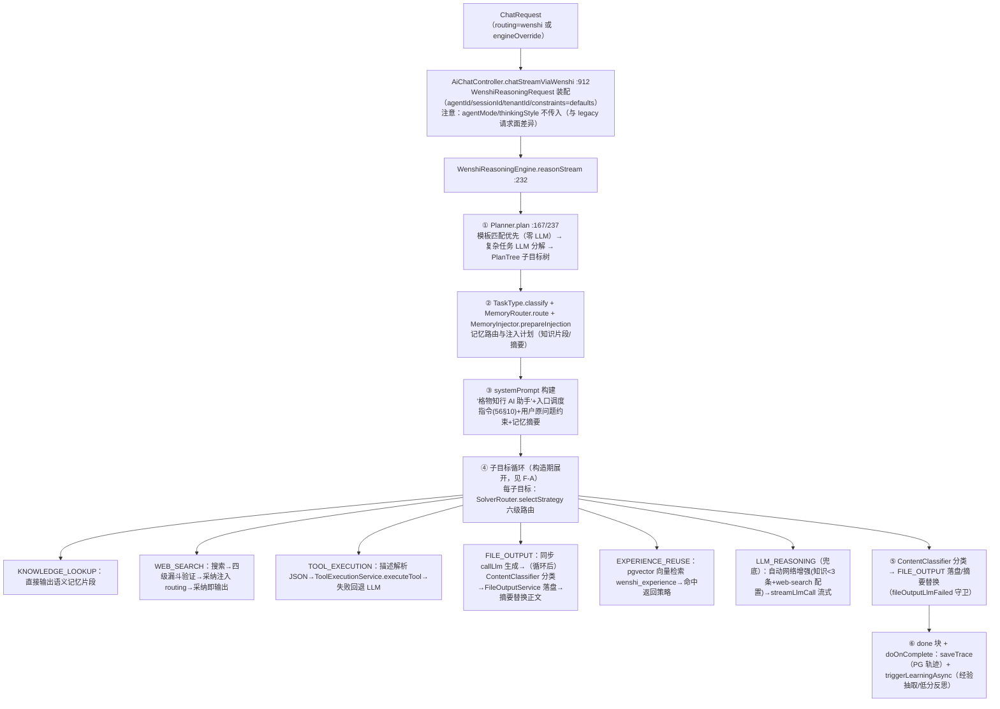

# wenshi 执行链全面分析报告（当前状态实证）

> **文档编号**：analysis-wenshi-chain-2026-11｜**日期**：2026-11-17｜**基线**：b2e7c2c..2a6f3a6 工作区（@36 commits）｜**方法**：链路核心 6 文件亲读（入口装配/WenshiReasoningEngine 1122 行/Planner/SolverRouter/Critic）+ 子系统调用点交叉核验
> **上游衔接**：docs/analysis/agent-engine-design-analysis-2026-11.md（引擎侧）· 45 号裁剪数据 · REEVAL 首评（REEVAL_HOLD，2026-11-17 真实 LLM）
> **一句话定位**：wenshi 执行链是一条**宿主应用层的认知编排对话链**——"Planner 分解 → 六策略路由求解 → Critic 验证 → 内容分类/文件化"，与引擎 ReAct 循环完全无关、互不共享执行内核；它同时是引擎的知识/记忆/经验供给层。

---

## 一、链路全景（端到端）



---

## 二、逐级实证

### 2.1 入口装配（AiChatController :862/:912）

- **请求面差异**：wenshi 请求不携带 agentMode/thinkingStyle（legacy 携带），改带 projectId/requirementId/constraints=defaults（enableWebSearch/enableExperience 默认开）；
- **账本**：同步路径 beginExecutionRecord→endExecutionRecord 完整；流式路径账本在 chatStream 体内（wenshiExecId doOnTerminate 回写）；
- **事件面差异**：wenshi chunk 携带 **webSearch/verify/file 三类 legacy 没有的事件**（搜索卡片/验证结论/文件卡片——前端有对应消费）；反过来 legacy 的 budget_warning/plan_*/subagent_* 事件 wenshi 不发。

### 2.2 WenshiReasoningEngine（1122 行，编排核心）

- **依赖 19 个协作者**（Planner/SolverRouter/Critic/MemoryRouter/MemoryInjector/WebSearchService/WebResultVerifier/ToolExecutionService/ExperienceMapper+EmbeddingAdapter/ExperienceExtractor/ReflectionAgent/ContentClassifier/FileOutputService/LlmClientFactory/ModelConfigService/SessionContextService/TraceMapper/TurnSteeringQueue/EntryFileService）——**认知域全自持，与引擎零共享**；
- **LLM 接入**：经宿主 `LlmClientFactory`（非引擎 LlmClientRegistry），default-provider/model 可被 env 覆盖（本轮 reeval 即 ark-code→agent-plan 切换）；
- **reasonStream 结构**：planFlux 以 `concatWith` 链式组装，全部片段在方法返回前构造完毕（见 F-A）；循环体内按策略分支内联执行；会话历史仅在 `streamLlmCall` 注入（最近 20 条+4000 token 压缩，S6 修复）。

### 2.3 Planner（278 行）

模板匹配优先（零 LLM 调用、低延迟）→ 复杂任务回退 LLM 分解。**缺陷**：分解质量依赖模板覆盖度；LLM 分解走 default provider。

### 2.4 SolverRouter（236 行）——六级优先路由

```
经验复用（pgvector 命中且 score≥阈值）→ 知识查找（语义记忆非空）→ 网络搜索（约束允许）
→ 规则匹配（工具执行）→ 文件输出 → 兜底 LLM_REASONING
```
设计意图清晰（经验优先降低 LLM 成本），但**经验库当前空置**（REEVAL 语境）→ 实际生效路由 = 知识查找/网络/LLM 三级。

### 2.5 六策略执行体（:663-928）

- **KNOWLEDGE_LOOKUP**：直接拼接语义记忆片段（743 片段灌入后此策略命中率上升）；空则回退 LLM；
- **WEB_SEARCH**：搜索→四级漏斗验证→采纳注入 routing（知识融合）→采纳即输出（省 LLM）；无采纳回退 LLM；
- **TOOL_EXECUTION**：从子目标描述解析 JSON 工具名/参数→ToolExecutionService.executeTool（**宿主工具服务，非引擎 ToolExecutor 五段管线**——无安全五层）；失败回退 LLM；
- **FILE_OUTPUT**：同步 callLlm 生成完整内容→ContentClassifier 分类→FileOutputService 落盘→摘要替换正文；失败守卫（fileOutputLlmFailed 标志，用户实报修复）；
- **EXPERIENCE_REUSE**：pgvector 向量检索经验库（空置→回退 LLM）；
- **LLM_REASONING**：自动网络增强（本地知识<3 条时）→callLlm。

### 2.6 Critic（236 行）——三级验证

外部验证（Solution.externalVerification，**wenshi 链路从不设置**→恒 null）→ 规则验证（**仅空值检查**）→ LLM 自检（**:139 硬编码 `getClient("deepseek")`**）。**F-B 实锤**：deepseek status=2 无 key → getClient 抛"不支持的 LLM 提供商" → LLM 自检不可用 → **Critic 实际退化为"输出非空即通过"的规则层**——三层验证名存实亡（REEVAL 数据平局的机制之一）。

### 2.7 响应装配与周边

- **内容分类/文件化**（:461-510）：ContentClassifier 判 FILE_OUTPUT→FileOutputService.generateFiles→文件卡片事件→摘要替换正文；失败回退直接输出（守卫完备）；
- **轨迹持久化**：saveTrace→wenshi_reasoning_trace（失败不阻塞）；`traceSteps` 用 `.toString()` 序列化（非结构化，学习层消费受限）；
- **学习闭环**：triggerLearningAsync（CompletableFuture.runAsync）——经验抽取→低分（<0.6 或 FAIL）触发 ReflectionAgent。**F-E**：log 行在 exp 判定外，exp==null 时 NPE 被 catch 吞（日志误报风险）。

---

## 三、新发现（本轮亲读实证，均为 wenshi 链特有）

| # | 发现 | 证据 | 级别 |
|---|---|---|---|
| F-A | **reasonStream 构造期副作用**：WEB_SEARCH 搜索/FILE_OUTPUT 同步 callLlm/KNOWLEDGE_LOOKUP 拼接都在 Flux **组装期**同步执行（:305-435 循环体内直接调用），非订阅期——"流式"实为"组装期批量预执行+事后顺序播放"；首个 chunk 发出时全部子目标已执行完毕 | :288-459 循环体结构 | S3 |
| F-B | **Critic 三级验证名存实亡**：:139 硬编码 `getClient("deepseek")`（status=2 无 key）→ LLM 自检恒失败 → 实际仅"输出非空即过"——三层验证退化为规则层，REEVAL 平局的机制性原因之一 | Critic.java:139 + :59-70 | S2 |
| F-C | **同步/流式双实现漂移**：reason() 走 executeSubgoals/executeSingleSubgoal，reasonStream() 内联另一套策略分支——策略语义两处维护（与 MessageBuilder 双处维护同类前科） | :615-701 vs :288-459 | S3 |
| F-D | **统计失真**：tokenStats.llmCallCount 硬编码 1（:207）；流式 tokens=length/4 估算；traceSteps 用 toString() 序列化（学习层消费受限） | :207/:1126 区 | S3 |
| F-F | **callLlm 无会话历史**（仅 streamLlmCall 注入 20 条历史）——同步路径/回退路径多轮上下文缺失（S6 修复未覆盖 callLlm） | :957-994 | S3 |
| F-E | triggerLearningAsync 的 log 行在 exp 判定外——exp==null 时 NPE 被 catch 吞（日志误报风险） | :1116-1120 | S4 |
| F-G | 入口请求面差异：agentMode/thinkingStyle 不传入 wenshi（legacy 携带）——模式/思维指令在 wenshi 链路失效 | AiChatController :868-876 | S3 |

---

## 四、与引擎链的对比（REEVAL_HOLD 的机制解释）

| 维度 | 引擎链（legacy） | wenshi 链 | 对 reeval 数据的影响 |
|---|---|---|---|
| LLM 调用 | **一次**主推理（循环内多轮按需）+ 工具并行 | 每子目标一次独立调用（N 子目标=N 次串行） | 时长 2.4x 的机制根源 |
| 记忆/知识注入 | MemoryRouter 注入 system（同一 wenshi 供给） | 同一供给 + 每子目标重复 prepareInjection | 两组评分趋同（REEVAL 平局的原因） |
| 差异化能力 | 工具循环/内置五件套/预算/安全五层 | 网络搜索增强/文件化/经验复用 | 题集（QA/代码）未触及 wenshi 差异化面 → 平局 |
| 验证 | 无独立 Critic（经验沉淀门控） | Critic 三级（退化仅空值检查） | 评分同为启发式（evaluateResponse 关键词命中） |

**结论**：REEVAL_HOLD（0.75 平局）在机制上可解释——两组共享同一 LLM/同一启发式评分/同一知识供给，差异仅在编排形态；而编排形态差异（并行工具循环 vs 逐子目标串行）恰是题集未覆盖的维度。**wenshi 要在复评中胜出，题集必须覆盖其差异化能力**（实时信息/文件产出/多步分解任务）——这是 45 号题集设计的改进点。

---

## 五、升级要点（按收益排序）

1. **F-B 修复（S2，0.5 人日）**：Critic :139 硬编码 deepseek → resolveProviderAndModel 或注入 judge 配置；LLM 自检恢复后 Critic 才有牙齿；
2. **F-A 修复（S2，1 人日）**：reasonStream 组装期副作用 → Flux.defer 包裹每子目标（真流式+顺序保证）；同时消除"全部预执行"的时序问题；
3. **F-C 收口（S3，1 人日）**：同步/流式双实现合并为单一策略执行器（与 MessageBuilder 收口同模式）；
4. **F-F/G 补齐（S3）**：callLlm 注入会话历史；wenshi 请求面补 agentMode/thinkingStyle 透传；
5. **题集改进（复评有效性的关键）**：45 号题集加入 wenshi 差异化场景（实时信息查询/文件产出/多步分解）——否则 reeval 永远 HOLD；
6. 步 5 预算钩子口径一致：wenshi 链无预算面——若重启 wenshi 执行链，预算/安全差距是首要补齐项。

## 六、核心文件索引

| 关注点 | 文件 |
|---|---|
| 入口装配/事件映射 | gewu-interface/.../AiChatController.java :862-1010 |
| 编排核心 | gewu-application/.../wenshi/reasoning/WenshiReasoningEngine.java（1122 行） |
| 三层实现 | 同包 Planner.java / SolverRouter.java / Critic.java |
| 知识供给 | 同包 knowledge/（SemanticMemoryService/MemoryInjector/KnowledgeIngestionStartupRunner） |
| 搜索验证 | 同包 search/（WebSearchService/WebResultVerifier 四级漏斗） |
| 评测域 | 同包 evaluation/（EvaluationRunner/QualityBaselineRunner/WenshiReevaluationTrigger） |
